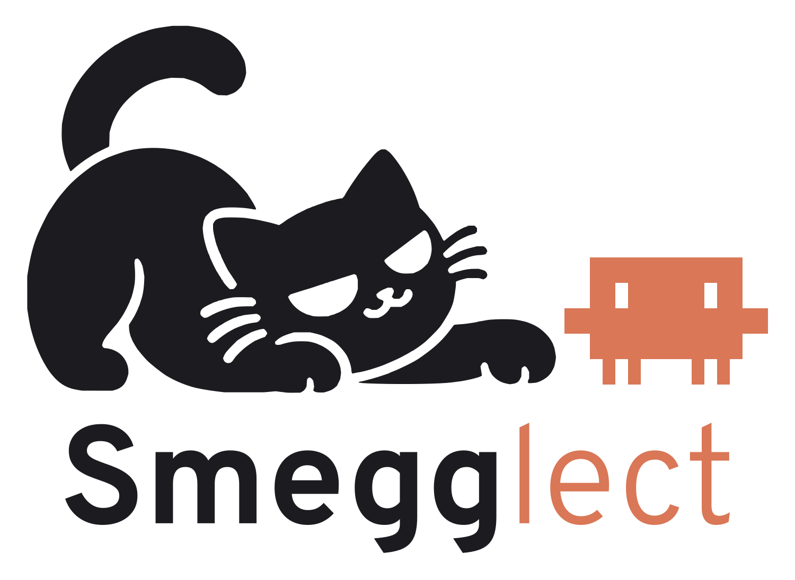
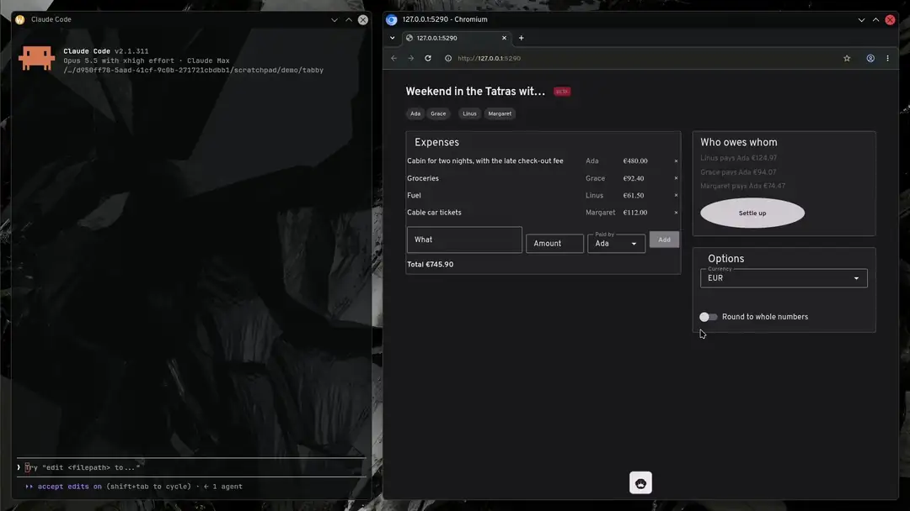

<h1 align="center">
  <picture>
    <source media="(prefers-color-scheme: dark)" srcset="assets/smegglect.svg">
    
  </picture>
</h1>

<p align="center">
  Point at what is wrong in your running app, say what is wrong, and hand it to Claude Code.
</p>

<p align="center">
  <a href="assets/demo.mp4">
    
  </a>
</p>

<p align="center">
  <a href="assets/demo.mp4"><b>Watch the full-quality demo (MP4, 1:41)</b></a>
</p>

Smegglect is an overlay for your app's dev server: a Vite or Nuxt app, a plain page, or a Wails desktop app.
Pick an element or drag a region, say what is wrong, and send it. Claude Code fixes it in your source,
checks it on the open page, and you watch each issue go from "Claude has it" to "Fixed: check it".

## Set up

Easiest: ask your coding agent, in your project folder:

```text
Add Smegglect to this app, following https://github.com/smegg99/Smegglect/blob/main/INSTALL.md
```

By hand, for a Vite app:

```sh
npm install -D smegglect @modelcontextprotocol/sdk zod
npx smegglect-bridge init
```

```ts
// vite.config.ts
import smegglect from 'smegglect/vite'

export default defineConfig({
  plugins: [smegglect({ project: { id: 'my-app' }, bridge: true })],
})
```

For Nuxt, add `modules: ['smegglect/nuxt']` and `smegglect: { project: { id: 'my-app' }, bridge: true }`
to `nuxt.config.ts` instead. Smegglect runs on the dev server only; a production build does not contain it.

## Use

1. Open your app on the dev server and click the paw at the bottom.
2. Press **Pick** and click an element, or **Region** and drag around several.
3. Choose what is wrong from the list, add a note if it helps, and press **Add issue**.
4. Open **Issues** and press **Send to Claude**. In Claude Code, in the same folder, type `/smegglect`.

No Claude Code? **Copy prompt** or **Download .zip** gives any agent or developer the same report.

## Good to know

- Tested in Chromium and Firefox, with Vue 3, Nuxt 4 and plain pages, and with Wails v3 on Linux.
  Windows and macOS webviews are not tested yet.
- It records what you point at: element names, sizes, the component and file that render it. Never input
  values or query strings; secret-looking text is masked. Nothing leaves your machine.

Everything else (every option, the keys, Wails, the agent bridge, security details, development) is in
[GUIDE.md](GUIDE.md).

## License

GNU Affero General Public License v3.0 only. See [LICENSE](LICENSE).
